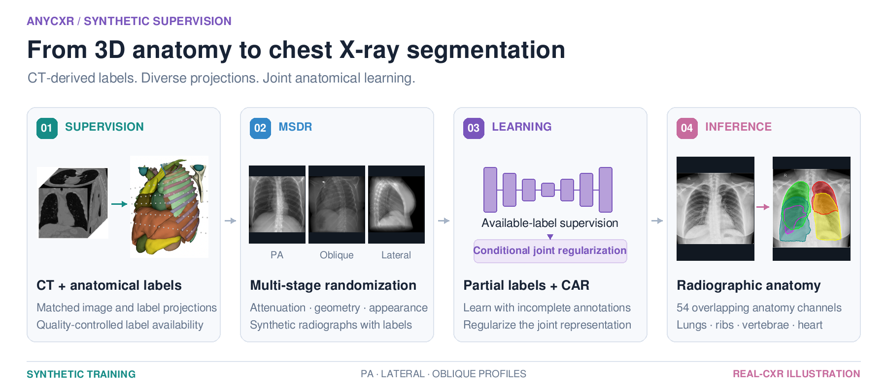
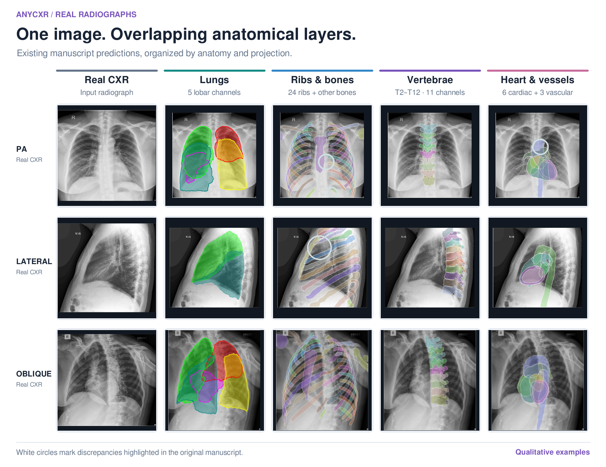

<p align="center">
  
</p>
<h2 align="center">Anatomical segmentation of chest X-rays<br>with synthetic supervision</h2>
<p align="center">
  <b>54 anatomical structures · PA, lateral &amp; oblique views</b><br>
  Multi-stage Domain Randomization &amp; Conditional Joint Annotation Regularization
</p>
<p align="center">
  Zifei Dong*, Wenjie Wu*, Jinkui Hao, Tianqi Chen, Ziqiao Weng, Bo Zhou<br>
  <sub>* Equal contribution</sub>
</p>
<p align="center">
  <a href="https://huggingface.co/agaresd/anychest-inference"></a>
  <a href="#installation"></a>
  <a href="#quick-start"></a>
  <a href="#anatomical-structures"></a>
  <a href="#training"></a>
</p>
<p align="center">
  
</p>

**AnyCXR** learns chest X-ray anatomy from CT-derived synthetic radiographs and partial anatomical labels. Multi-stage Domain Randomization (MSDR) varies projection geometry and image appearance, while Conditional Joint Annotation Regularization (CAR) models joint anatomy under incomplete supervision. The inference package exports 54 anatomical channels as masks and color overlays.

This is the **primary lab repository** for AnyCXR. The current inference release includes the package, example inputs and outputs, Docker support, and evaluation scripts. The repository also contains [training source and configuration templates](training/README.md), plus [full/inference checkpoint placeholders](checkpoints/README.md) for the next release. An experimental [frontal ConvNeXtV2 training and inference route](training/frontal/README.md) is also available; new weights remain unpublished.

[Installation](#installation) · [Quick start](#quick-start) · [Model weights](#model-weights) · [Structures](#anatomical-structures) · [Method](#method) · [Training](#training) · [Evaluation](#evaluation) · [Citation](#citation)

## Anatomy on real chest X-rays

<p align="center">
  <a href="docs/assets/anycxr-real-anatomy.png"></a>
</p>

**Lungs → ribs → vertebrae → heart and vessels.** These are the existing real-CXR examples from the manuscript's `Real_compare.png`, arranged by anatomical group. Each row shows one input and its grouped predictions; the three views are separate examples, with no asserted cross-view patient correspondence. White circles retain the manuscript's highlighted prediction discrepancies. The examples illustrate the manuscript model and are not a new accuracy benchmark or outputs from the unpublished frontal candidate.

Browse all **54 supported output channels** in the [anatomy catalog](docs/anatomy.md), or use the [machine-readable JSON](docs/anatomy.json) for group names, class names and exact channel indices. [Figure sources and reproduction](docs/assets/README.md) document the original panels and composition.

## Installation

Python **3.9 or newer** is required. Create an isolated environment, then install from this repository:

```bash
git clone https://github.com/Advanced-AI-in-Medicine-and-Physics-Lab/AnyCXR.git
cd AnyCXR
python -m venv .venv
source .venv/bin/activate
python -m pip install --upgrade pip
python -m pip install -e .
anychest-infer --help
```

The project is named AnyCXR; the installed command retains its existing name, **`anychest-infer`**. The package installs PyTorch and the image-processing dependencies declared in [pyproject.toml](pyproject.toml). For GPU inference, use a PyTorch build compatible with your CUDA environment. CPU inference is available with `--device cpu`.

## Model weights

Download the inference bundle from [Hugging Face → agaresd/anychest-inference](https://huggingface.co/agaresd/anychest-inference):

```bash
python -m pip install huggingface_hub
hf download agaresd/anychest-inference anychest_inference_bundle.pt --local-dir ./weights
```

The bundle contains **three model checkpoints**: PA, lateral and oblique. Six angle-specific oblique profiles select the shared oblique checkpoint and the matching view metadata.

| Projection | CLI profile | Checkpoint in the bundle |
| --- | --- | --- |
| PA | `pa` | `pa` |
| Lateral | `la` | `la` |
| Oblique, 22.5° | `oblique_22_5` | `oblique` |
| Oblique, 45° | `oblique_45` | `oblique` |
| Oblique, 67.5° | `oblique_67_5` | `oblique` |
| Oblique, 112.5° | `oblique_112_5` | `oblique` |
| Oblique, 135° | `oblique_135` | `oblique` |
| Oblique, 157.5° | `oblique_157_5` | `oblique` |

Use `--profile oblique` for a dataset-style directory with view-specific subfolders. For a single image or a flat folder, choose an angle-specific profile. The release does not provide a separate AP checkpoint or continuous angle estimation.

This bundle is **inference-only**: optimizer and scheduler states were removed.

### Next release: full and inference-only checkpoints

| Model | Full training checkpoints | Inference-only checkpoint | Availability |
| --- | --- | --- | --- |
| PA | Latest, best without CAR, best with CAR | PA weights | **Placeholder** |
| Lateral | Latest, best without CAR, best with CAR | Lateral weights | **Placeholder** |
| Oblique | Latest, best without CAR, best with CAR | Shared oblique weights | **Placeholder** |
| Combined | — | PA + lateral + oblique bundle | **Placeholder** |

The [checkpoint registry](checkpoints/README.md) reserves **13 legacy artifacts** plus a separate experimental frontal full/inference pair. Full checkpoints and slim inference weights will be prepared as two HF release types, with [model-card templates](hf/README.md) already in the repository. New HF repository names and weights are unassigned; the entries above are not download links and do not replace the existing bundle.

## Quick start

Run the bundled PA example:

```bash
anychest-infer \
  --input-path examples/inputs/pa/t_10955_a_1.png \
  --output-dir outputs/pa \
  --checkpoint weights/anychest_inference_bundle.pt \
  --profile pa \
  --device cpu
```

For a lateral radiograph, use `--profile la`. For a 45° oblique radiograph, use `--profile oblique_45`:

```bash
anychest-infer \
  --input-path /path/to/image.png \
  --output-dir outputs/oblique \
  --checkpoint weights/anychest_inference_bundle.pt \
  --profile oblique_45 \
  --device cuda:0
```

`--input-path` accepts a single **PNG, JPEG or DICOM** file, a flat folder, or a dataset-style directory such as `PA/imagesTr`, `LA/imagesTr` and `45/imagesTr`. A profile selects the model and view metadata; it does not infer the acquisition angle from the image.

### Outputs and settings

The default output contains a separate PNG mask for every class and a color overlay, organized by view:

```text
outputs/pa/PA/
├── labelsTr/
│   └── t_10955_a_1/
│       ├── heart.png
│       ├── lung_upper_lobe_left.png
│       ├── rib_left_1.png
│       └── ...
└── overlays/
    └── t_10955_a_1_overlay.png
```

| Option | Purpose | Default |
| --- | --- | --- |
| `--device` | PyTorch device: `cpu`, `cuda:0`, etc. | `cuda:0` |
| `--batch-size` | Number of images per inference batch | `8` |
| `--save-format` | PNG masks (`img`) or NumPy arrays (`npy`) | `img` |
| `--save-option` | Per-image mask folder (`sep`), flat class files (`one`), or `_total` folder (`total`) | `sep` |
| `--disable-overlays` | Skip color overlay export | Off |
| `--view-name` | Explicit view metadata for ambiguous inputs | Inferred from profile/layout |
| `--metadata-json` | Override the packaged reference JSON | Packaged reference |

All save modes retain separate anatomical channels. Projected structures can overlap, so the output is not a single mutually exclusive label map. See `anychest-infer --help` for all options.

### Docker

The provided Docker image uses a CPU PyTorch base:

```bash
docker build -t anycxr-infer .
docker run --rm anycxr-infer --help
```

Mount the checkout to provide images, weights and an output directory:

```bash
docker run --rm \
  -v "$PWD:/workspace/AnyCXR" \
  anycxr-infer \
  --input-path examples/inputs/pa/t_10955_a_1.png \
  --output-dir outputs/pa \
  --checkpoint weights/anychest_inference_bundle.pt \
  --profile pa --device cpu
```

## Anatomical structures

The [anatomy catalog](docs/anatomy.md) lists every supported structure, and the [machine-readable anatomy JSON](docs/anatomy.json) provides its group and **zero-based channel index**. Both are generated from the packaged [reference JSON](cxas/data/anychest_reference.json), which remains the source of truth for the exact **54-channel output order**, view names and dataset-folder mapping. These counts describe the output taxonomy, not per-structure accuracy.

| Group | Channels | Structures |
| --- | ---: | --- |
| Lungs | 5 | Left upper/lower lobes; right upper/middle/lower lobes |
| Ribs | 24 | Left and right ribs 1–12 |
| Thoracic vertebrae | 11 | T2–T12 |
| Heart and vessels | 9 | Whole heart, left/right ventricles, left/right atria, myocardium; pulmonary artery, `aorta`, `aorta_long` |
| Other bones | 5 | Left/right clavicles, left/right humeri, sternum |

The `aorta` and `aorta_long` names denote separate legacy channels; the packaged reference does not specify a finer anatomical distinction. Left/right names refer to the patient's anatomy. Independent channels preserve overlapping projected structures.

<details>
<summary><b>Show all 54 class names in inference order</b></summary>

```text
heart_ventricle_left, heart_atrium_left, heart_ventricle_right,
heart_atrium_right, heart_myocardium, pulmonary_artery, heart,
rib_left_1, rib_left_2, rib_left_3, rib_left_4, rib_left_5, rib_left_6,
rib_left_7, rib_left_8, rib_left_9, rib_left_10, rib_left_11, rib_left_12,
rib_right_1, rib_right_2, rib_right_3, rib_right_4, rib_right_5, rib_right_6,
rib_right_7, rib_right_8, rib_right_9, rib_right_10, rib_right_11, rib_right_12,
aorta, vertebrae_T2, vertebrae_T3, vertebrae_T4, vertebrae_T5,
vertebrae_T6, vertebrae_T7, vertebrae_T8, vertebrae_T9, vertebrae_T10,
vertebrae_T11, vertebrae_T12, aorta_long,
lung_upper_lobe_left, lung_upper_lobe_right, lung_middle_lobe_right,
lung_lower_lobe_left, lung_lower_lobe_right,
clavicula_left, clavicula_right, humerus_left, humerus_right, sternum
```

</details>

## Method

The overview at the top adapts the manuscript's CT and 3D anatomy illustrations into the four-stage workflow below.

1. **Synthetic supervision.** Project CT volumes and anatomical labels into matched radiographs and segmentation targets. Quality control determines which class labels are available.
2. **Multi-stage Domain Randomization (MSDR).** Perturb the CT appearance, projection geometry, and detector/display appearance to diversify the synthetic training domain.
3. **Partial-label learning with CAR.** Supervise available classes and regularize the joint anatomical representation conditional on the image, allowing training with incomplete annotations.
4. **Anatomical inference.** Apply the trained model to chest radiographs using the appropriate view profile; export masks for analysis and overlays for inspection.

The top overview combines manuscript illustrations with bundled **synthetic radiographs**; the anatomy gallery shows the original **real-CXR predictions**. The manuscript's real-CXR reference annotations were refined from model predictions, which limits claims of independent segmentation accuracy, particularly for ambiguous soft-tissue boundaries. Review predictions for the intended research use.

## Examples

[examples/](examples/README.md) contains inputs and existing outputs for PA, lateral and 45° oblique profiles. To regenerate them after downloading the weights:

```bash
DEVICE=cpu bash scripts/build_example_cases.sh
```

These runnable synthetic examples are separate from the real-CXR manuscript gallery above. Both README figures are composed from existing material; no additional inference or training was used. Rebuild them and the anatomy catalogs with `python scripts/build_readme_assets.py`; see the [asset documentation](docs/assets/README.md).

## Training

The [training directory](training/README.md) includes the retained AnyCXR U-Net/CAR trainer and PA, lateral and oblique configuration templates. Inspect the preparation plan without loading models or accessing image data:

```bash
python training/train.py --config training/configs/pa.json --dry-run
```

This reports the unfilled data/split/output fields and reserved legacy checkpoint slots. **This legacy entry point remains preparation-only.**

For executable AP/PA training, see the [experimental frontal route](training/frontal/README.md): real-CXR encoder initialization, fresh CAS-lite/AMFS segmentation decoder, patient-group exclusion across D3 and CT/DRR, exact distributed validation, and paired full/inference checkpoint export. It uses 384-pixel inputs and 96-grid outputs. Exported Phase A/B weights have passed strict loading and FP32 AP/PA prediction parity checks; they remain unpublished candidates. Install optional dependencies with `python -m pip install -e '.[train,frontal]'`.

## Evaluation

For a separately obtained Dataset003-style test set with reference masks:

```bash
DATASET_DIR=/path/to/Dataset003_Full/test_case \
CHECKPOINT_PATH=./weights/anychest_inference_bundle.pt \
DEVICE=cuda:0 \
bash scripts/reproduce_main_eval.sh
```

The script evaluates PA, lateral and oblique profiles and writes `per_image_dice.csv`, `per_class_summary.csv` and `summary.json` under each profile's `reports/` directory. The complete evaluation dataset is not included in this repository; the bundled examples are not a substitute for it. This workflow does not reproduce every experiment in the manuscript.

## Roadmap

- [x] Lab repository with the existing public inference package, examples and usage documentation.
- [x] Retain the AnyCXR training source and PA/lateral/oblique configuration templates.
- [x] Reserve paired full/inference checkpoint slots and prepare two HF model cards.
- [x] Integrate experimental frontal training, frozen group exclusions, full checkpoint state and verified inference export.
- [ ] Validate and select new frontal weights; keep legacy lateral/oblique training templates separate.
- [ ] Update the model and weights after the next checkpoint is supplied.
- [ ] Publish full training checkpoints and a separate inference-only bundle on Hugging Face.
- [ ] Prepare the FLUX and BAAI data workflow and evaluate retraining under a defined protocol.

The unchecked items describe future work and are not part of the current release.

## Citation

**AnyCXR: Human Anatomy Segmentation of Clinical Chest X-ray using Multi-stage Domain Randomized Synthetic Data with Imperfect Annotations and Conditional Joint Annotation Regularization Learning**<br>
Zifei Dong, Wenjie Wu, Jinkui Hao, Tianqi Chen, Ziqiao Weng, and Bo Zhou.

Publication metadata and a BibTeX entry will be added when available.

## License and acknowledgments

The lab repository's existing [Apache-2.0 license](LICENSE) is retained. The imported inference source retains its original [MIT copyright and license notice](LICENSES/AnyCXR-inference-MIT.txt); its package metadata also contains a legacy non-commercial declaration. These inherited declarations have not been reconciled in this migration. Checkpoint terms are maintained with the [Hugging Face model release](https://huggingface.co/agaresd/anychest-inference).

The separately imported training source retains its original [CC BY-NC-SA 4.0 license](training/legacy/LICENSE.txt). Future checkpoint terms remain to be established for the new release.

The initial inference release was maintained at [Agaresd47/AnyCXR](https://github.com/Agaresd47/AnyCXR). README organization and presentation were inspired by [TotalSegmentator](https://github.com/wasserth/TotalSegmentator) and [FleXray](https://flexray.csail.mit.edu/); all displayed segmentation examples are from AnyCXR.
